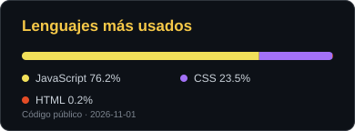
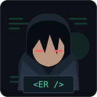
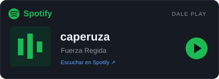

## Hola 👋, soy Ernesto Rayas

Desarrollo aplicaciones web con **JavaScript, React y Node.js**.

  

### Mi stack

  

  
  

 

### Un poco de código, un poco de arcade 👾

<picture>
  <source media="(prefers-color-scheme: dark)" srcset="./assets/pacman-contribution-graph-dark.svg" />
  <source media="(prefers-color-scheme: light)" srcset="./assets/pacman-contribution-graph.svg" />
  
</picture>

 

  

<b>🛍️ Proyecto destacado · Papelería Karen</b>

Aplicación web para una papelería: catálogo, carrito, favoritos, pedidos e inventario. Proyecto universitario en equipo con **React + Vite**, una **API Express** y **SQLite**.

[Explorar el código y la documentación →](https://github.com/ErnestoRayas/Proyecto_Papeleria)

